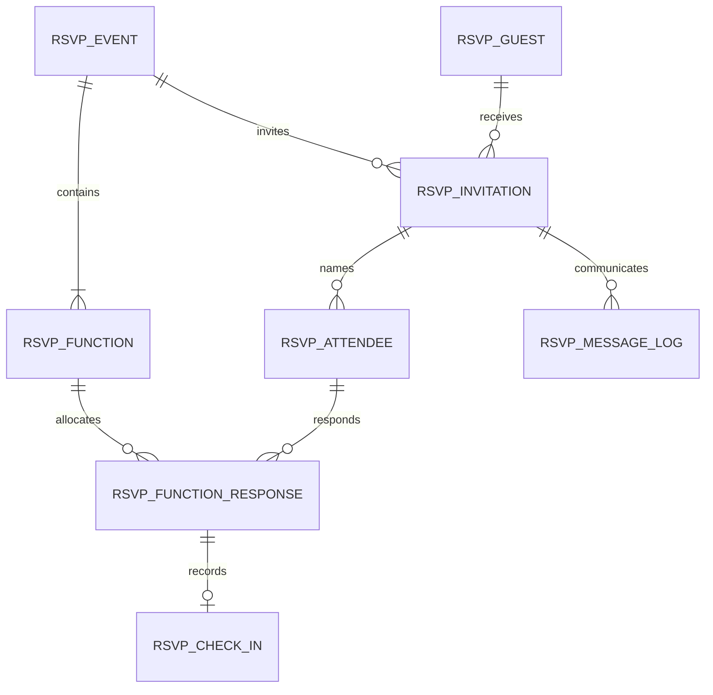

# Architecture

AV RSVP uses native Frappe metadata and Desk pages, with a server-rendered mobile guest page at `/rsvp`. It has no separate frontend build or ERPNext requirement.

## Data relationships

RSVP Event Team is a child table. RSVP Settings is a Single DocType. Attendees, responses, check-ins and message logs are independent documents with tracked changes, read-only Desk access and service-only write validation.

## Request boundary

Guest read/write/calendar endpoints accept private tokens through POST. Staff endpoints authorize against both assigned event team access and user roles. Generic DocType reads/list queries enforce the same event partition through permission hooks. Explicit field projections prevent guest and check-in APIs from returning internal secrets or unrelated personal information.

Operations that allocate/release capacity, revoke invitations, or record/reverse check-ins serialize on the RSVP Event row using Query Builder `for_update()`. Capacity decisions use locking current reads rather than snapshot counts, so a request waiting behind another booking cannot count an older transaction snapshot. No application service commits the request early. An exception must propagate to the Frappe transaction boundary; callers invoking the services directly must roll back on failure. Email background jobs are queued after commit.

Payload validation rejects foreign attendees, unknown/repeated functions, excess guest counts, invalid meals and disallowed Maybe responses before changing booking state. Existing confirmed places survive a replay at full capacity. Cancellation after check-in requires an explicit staff reversal.

A response key is the hash of attendee plus function; invitation uniqueness is event plus guest; the check-in response link is unique. Reversals reuse the check-in record, retaining history through Frappe Version records.

## Files

- `controllers.py`: DocType invariants and direct-write protection.
- `domain.py`: pure input/capacity rules.
- `permissions.py`: event assignment and list/document access.
- `security.py`: locks, invitation/pass tokens and service context.
- `services.py`: attendee/response allocation and check-in transactions.
- `api.py`: public/staff HTTP boundary and organiser operations.
- `messaging.py`: after-commit message jobs and Email Queue status reconciliation.
- `reporting.py`: event-scoped operational reports.
- `www/rsvp.*`: guest and staff-assisted response interface.
- `rsvp/page`: event overview and check-in pages.

## Installation compatibility

The native Dock and Sidebar paths and their schemas were checked against upstream Frappe `version-16`, commit `2fcb9397a1f1da353b21e53d2f97ec56653acd02`. The app's minimum is 16.50; deployments should use a current v16 patch release. Current upstream metadata may include refinements absent in early v16.50 versions. CI installs the current v16 branch and validates migration and navigation-record existence. This is not a compatibility claim for v15.

## Operational limits

Guest data is stored on the site's database; this release does not create separate tenant boundaries within one site. Use separate sites when organisers require complete administrative isolation. Waiting lists allocate individuals, check-in requires connectivity, and per-invitation allowances are capped at 100 people. Large-event load tests and a live-site user acceptance pass are required before production rollout.
